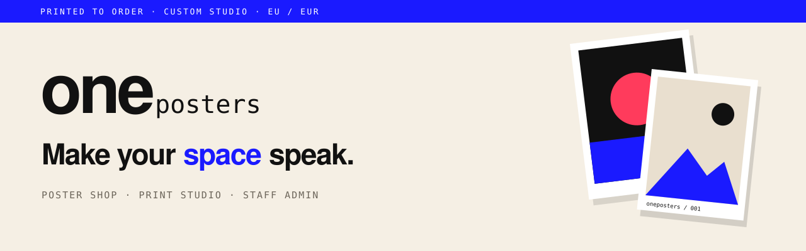
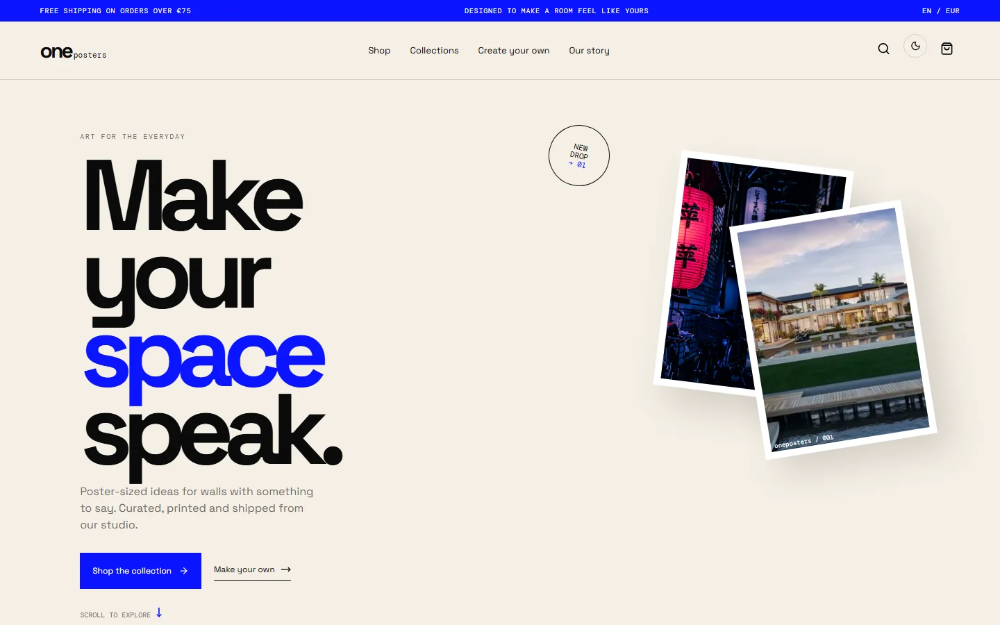
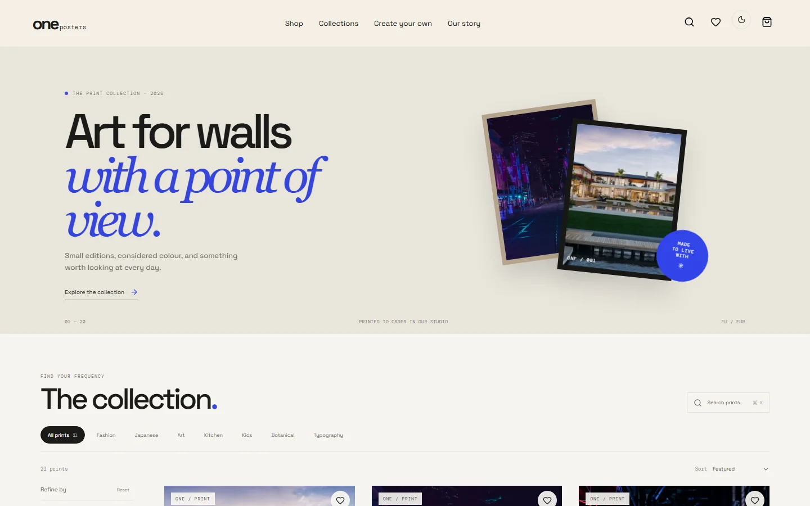
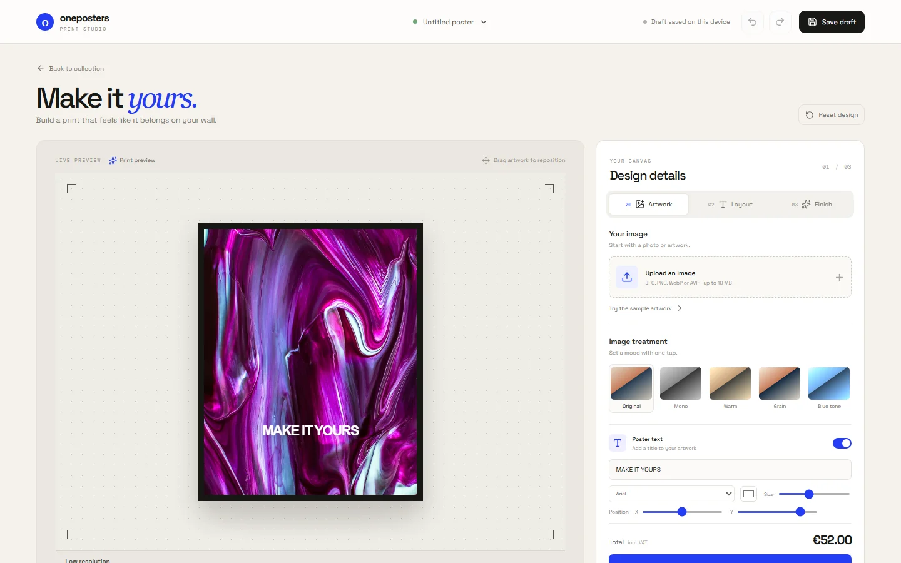
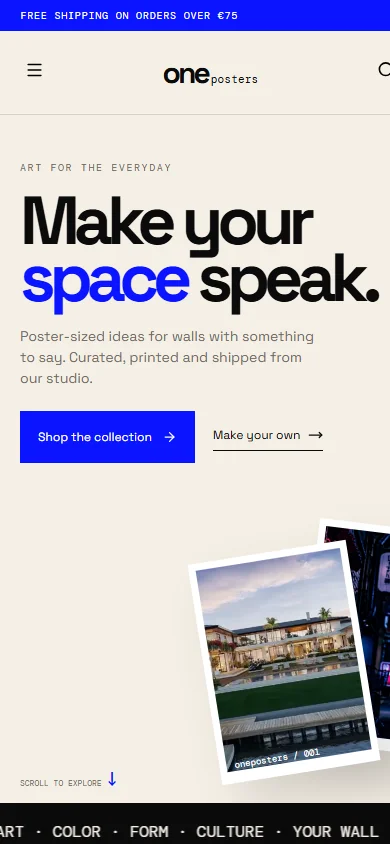
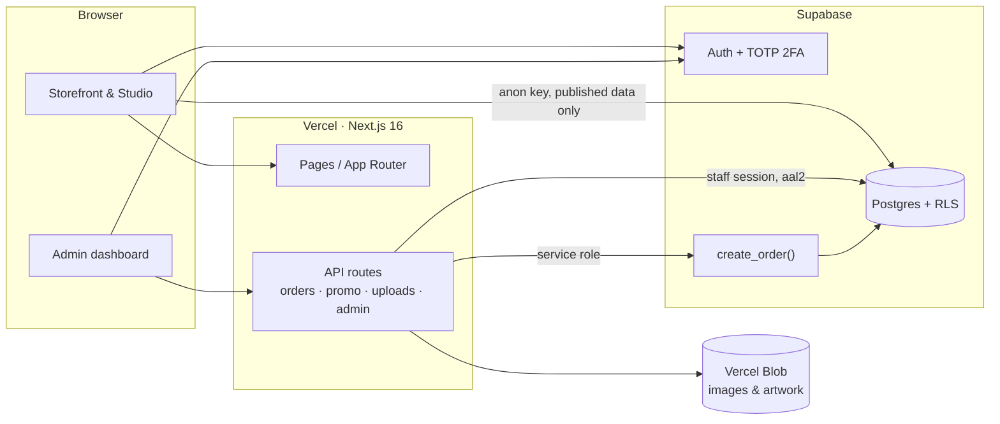

<div align="center">



**An online poster shop with a custom-print studio and a 2FA-protected staff admin.**

[**Live site**](https://oneposters.vercel.app) ·
[Shop](https://oneposters.vercel.app/shop) ·
[Studio](https://oneposters.vercel.app/studio) ·
[Releases](https://github.com/iligashi/oneposters/releases) ·
[Contributing](CONTRIBUTING.md) ·
[Security](SECURITY.md)

[](https://github.com/iligashi/oneposters/actions/workflows/ci.yml)
[](https://oneposters.vercel.app)
[](https://github.com/iligashi/oneposters/releases/tag/v1.0.0)


</div>

---

## Screenshots

<table>
  <tr>
    <td width="50%"><p align="center"><sub><b>Home</b>: editorial landing page</sub></p></td>
    <td width="50%"><p align="center"><sub><b>Shop</b>: live catalog with filters and search</sub></p></td>
  </tr>
  <tr>
    <td width="50%"><p align="center"><sub><b>Studio</b>: upload artwork, style it, order a custom print</sub></p></td>
    <td width="50%" align="center"><p align="center"><sub><b>Mobile</b>: fully responsive</sub></p></td>
  </tr>
</table>

## Features

| | |
|---|---|
| 🛍️ **Storefront** | Catalog, categories, sizes and frames, wishlist, recently viewed, search, cart with server-validated promo codes |
| 🎨 **Print studio** | Upload your own artwork, adjust treatment, text and layout, preview it in a room mockup, and order it as a custom print |
| 🧾 **Checkout** | Prices recomputed on the server; each order (customer, items, designs, discount use) saved together in one database transaction |
| 🛠️ **Staff admin** | Products, sizes and image galleries, orders with CSV export, customers, studio production queue, discounts, content, staff roles, audit log |
| 🔐 **Security** | Postgres row-level security, owner/manager/support roles, mandatory TOTP 2FA for staff, same-origin and rate-limit checks, upload validation by file contents, CSP headers, optional Turnstile bot check |
| ✅ **Quality** | TypeScript strict, Vitest unit tests, CI on every PR, Dependabot, preview deployment per PR |

## Architecture



Visitors can only read published catalog data. Every write goes through an API route that checks the
origin, rate limit and staff role. Orders are written by a single `create_order()` database function that only the
server can call. The full permission matrix is in [`supabase/README.md`](supabase/README.md).

## Tech stack

**App:** Next.js 16 (App Router, Turbopack) · React 19 · TypeScript · Tailwind CSS 4 + CSS modules · zustand · SWR · framer-motion
**Backend:** Supabase (Postgres, row-level security, Auth, TOTP MFA) · Vercel Blob · Vercel hosting
**Tooling:** pnpm · Vitest · GitHub Actions · Dependabot

## Getting started

Requires **Node.js 24** (see [`.nvmrc`](.nvmrc)) and **pnpm**, which Corepack provides at the version pinned in `package.json`.

```bash
git clone https://github.com/iligashi/oneposters.git
cd oneposters
corepack enable
pnpm install
cp .env.example .env.local     # or: vercel env pull .env.local
pnpm dev                       # http://localhost:3000
```

Every environment variable is documented in [`.env.example`](.env.example):

| Variable | Needed for |
|---|---|
| `NEXT_PUBLIC_SUPABASE_URL`, `NEXT_PUBLIC_SUPABASE_ANON_KEY` | Everything (storefront, auth) |
| `SUPABASE_SERVICE_ROLE_KEY` | Checkout and promo codes (server only) |
| `BLOB_READ_WRITE_TOKEN` | Product images and studio uploads |
| `NEXT_PUBLIC_TURNSTILE_SITE_KEY`, `TURNSTILE_SECRET_KEY` | Optional bot protection |
| `ERROR_WEBHOOK_URL` | Optional server error alerts |

## Scripts

| Command | Description |
|---|---|
| `pnpm dev` | Start the development server |
| `pnpm build` · `pnpm start` | Production build · serve it |
| `pnpm typecheck` | Type-check with `tsc --noEmit` |
| `pnpm test` | Run the unit tests (Vitest) |

## Database

Schema changes live in [`supabase/migrations`](supabase/migrations) and are applied **before** the code that needs them
is deployed. [`supabase/README.md`](supabase/README.md) covers applying migrations, the security model and creating the
first owner account.

## Project structure

```
app/                 Routes (App Router)
├─ admin/            Staff dashboard; sections/ has one module per admin page
├─ api/              Route handlers: orders, promo, studio uploads, admin CRUD, health
├─ shop/ product/    Catalog and product pages
└─ studio/           Custom print studio
components/          Shared storefront components
lib/                 Domain logic: pricing, orders, catalog, security, staff checks, Supabase clients
data/                Built-in sample catalog (fallback)
supabase/            Migrations and database docs
tests/               Unit tests
docs/                README assets
```

## Deployment

| Environment | Branch | URL |
|---|---|---|
| **Production** | `main` | [oneposters.vercel.app](https://oneposters.vercel.app) |
| Preview | every pull request | Posted on the PR by Vercel |

Releases are tagged on `main` using [semantic versioning](https://semver.org) and listed on the
[Releases page](https://github.com/iligashi/oneposters/releases).

## Contributing

Branch from `main`, keep pull requests focused, and make sure CI passes. Pull requests are squash-merged. Branch
naming, commit style and migration rules are in [CONTRIBUTING.md](CONTRIBUTING.md). Please report security issues
privately as described in [SECURITY.md](SECURITY.md), not as a public issue.

## License

**Proprietary.** Copyright © oneposters. All rights reserved. You may not use, copy, modify or distribute this code
without written permission.
